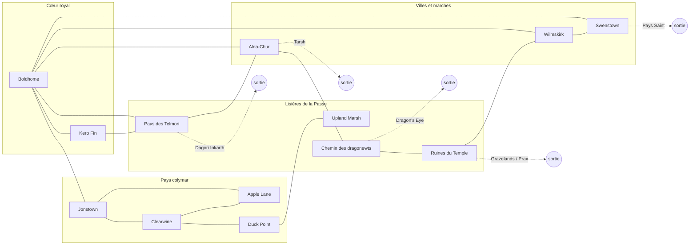

:::warning[En cours de conception]
Exploration de travail : première liste de lieux et de rencontres, tirée de la connaissance générale du lore, pour éprouver la formule de [provisionnement](../../conception/provisionnement.md). Ce ne sont ni des paragraphes, ni une allocation de numéros. Tout élément devra être confirmé selon la [discipline de source](../../conception/architecture.md#discipline-de-source) avant rédaction.
:::

# Sartar — provisionnement exploratoire

**Légende :** *(à vérifier)* = connaissance moins sûre (nom, position, détail) ; **[année]** = dépend de l'année de référence.

## 1. Préalable : l'année de référence

Sartar change de visage selon l'année retenue :

- **Pendant l'occupation lunaire** : Boldhome est tombée en 1602 ; la révolte de Kallyr Starbrow a été écrasée en 1613 ; l'Empire lunaire administre le royaume et édifie le Temple de la Lune Montante.
- **En 1625, après le Dragonrise** : le dragon s'éveille lors de la consécration du temple et l'anéantit avec l'armée qui s'y trouvait. Le pays bascule vers la libération, mais occupants, ralliés et rebelles s'y croisent encore.

**Proposition : 1625, après le Dragonrise.**

- C'est l'année de référence de *RuneQuest: Roleplaying in Glorantha* et de la production actuelle. Celui qui découvre Glorantha avec Discovery retrouvera ensuite le même monde, et les sources y sont les plus abondantes.
- Le pays est en mouvement. Des Héros sont de retour ou en marche : un aventurier peut les croiser sans être l'un d'eux.
- Les ruines du temple offrent un lieu de découverte saisissant, où l'Histoire vient tout juste de basculer.

La situation politique exacte de chaque lieu en 1625 (garnisons restantes, rois de tribu, allégeances) reste *à vérifier* dans les sources.

## 2. Le graphe

Topologie de travail. Les positions sont approximatives et à confronter à une carte de Sartar ; seules comptent ici les liaisons.

**13 lieux, 17 trajets, 5 sorties interlivres.** Le diamètre est de 6 trajets (d'Upland Marsh aux Ruines du Temple).

## 3. Lieux et rencontres

Pour chaque rencontre : ce que la **première visite** fait découvrir, puis ce que le joueur peut **revenir chercher**. Les Visions indiquées sont des affinités, pas des exclusivités.

### Cœur royal

**Boldhome — la cité du Prince.** Fondée par Sartar dans les monts Quivin, au pied de Kero Fin. La Flamme de Sartar y est éteinte depuis la chute de 1602. **[année]**

| Rencontre | Découverte | Revenir chercher | Visions |
| --- | --- | --- | --- |
| La Flamme éteinte | Le foyer royal, le mythe de Sartar le bâtisseur et de sa lignée | Le mythe de Sartar ; ce qu'exigerait de rallumer la Flamme | Théisme |
| Les partisans du Prince | Les prétendants et leurs fidèles ; Kallyr Starbrow **[année]** | Une alliance, un renfort, la relation avec une Héroïne | toutes |
| Le marché d'Issaries | Marchands, nouvelles de Prax, d'Esrolia, de Tarsh | Un objet, un guide, un passage | toutes |
| Les Lunars dans la cité **[année]** | L'occupant de près : fonctionnaires, soldats, temple | Un laissez-passer, un renseignement… ou un nom barré | toutes |
| La garde et les épées d'Humakt *(à vérifier)* | Le code de la mort et de l'honneur | Un renfort, une épreuve d'honneur | Théisme |

**Kero Fin — la Montagne-Mère.** Mère d'Orlanth, sommet sacré de la Passe du Dragon.

| Rencontre | Découverte | Revenir chercher | Visions |
| --- | --- | --- | --- |
| Le sentier des pèlerins | Le mythe de la naissance d'Orlanth | Un mythe central pour une Quête orlanthie | Théisme |
| Les vents de la montagne | Les vents comme présences vivantes | Un esprit de l'Air, un rite des vents | Animisme, Théisme |
| Monter plus haut | Là où le monde touche celui des dieux | Une épreuve [III] ; une compréhension Air / Terre *(nature de Kero Fin à vérifier)* | Mysticisme |

### Pays colymar

**Jonstown — la cité de la Bibliothèque.** La grande bibliothèque de Lhankor Mhy, mémoire du royaume.

| Rencontre | Découverte | Revenir chercher | Visions |
| --- | --- | --- | --- |
| La Bibliothèque | Les sages, les rouleaux, la manière dont Glorantha se souvient | Un mythe consigné ; un texte étranger d'opération, au prix d'une dette | Théisme, Logique |
| Un sage renommé (Minaryth Purple ? *à vérifier*) | Un esprit érudit, curieux du voyageur | Un conseil sur la Quête, une relation | toutes |
| Les caravanes | La route, les marchands, ceux qui partent | Un compagnon de route, des nouvelles | toutes |
| La ville et ses maîtres **[année]** | Qui tient Jonstown, et comment | Une faveur, un accès | toutes |

**Clearwine — le cœur des Colymar.** Le fort de la tribu et son temple de la Terre.

| Rencontre | Découverte | Revenir chercher | Visions |
| --- | --- | --- | --- |
| Le Temple de la Terre | Ernalda, ses prêtresses, les gardiennes de Babeester Gor | Le mythe d'Ernalda, épouse d'Orlanth ; une alliance ; un soin | Théisme |
| Le roi des Colymar (Kangharl ? *à vérifier*) **[année]** | La politique tribale, la tentation de la collaboration | Une faveur, une relation… ou un nom barré | toutes |
| L'assemblée de la tribu | Le droit orlanthi, les querelles de clans | Une reconnaissance, le renfort d'un clan | toutes |
| Les ancêtres du clan | Le culte des morts qui veillent | Un esprit ancestral, une mémoire de lignée | Animisme |

**Apple Lane — le hameau sur la route.** Petit lieu de passage, que la tradition de RuneQuest a rendu célèbre.

| Rencontre | Découverte | Revenir chercher | Visions |
| --- | --- | --- | --- |
| La boutique de Gringle | Le prêteur sur gages et ses objets venus d'ailleurs | Un objet singulier | toutes |
| L'auberge | Voyageurs et rumeurs, qui ouvrent vers d'autres lieux | Un compagnon, une piste | toutes |
| Les Monticules Arc-en-ciel *(à vérifier)* | Un site ancien près du hameau | Un secret, un mythe local | Animisme, Mysticisme |

**Duck Point — les durulz.** Le peuple-canard, méprisé et chassé, au bord du marais.

| Rencontre | Découverte | Revenir chercher | Visions |
| --- | --- | --- | --- |
| Le village durulz | Un peuple moqué, des primes lunaires sur leurs têtes **[année]** | Une relation, un renfort inattendu | toutes |
| La rivière | L'esprit, ou le dieu, du cours d'eau | Un esprit de l'Eau, un passage | Animisme |
| Les guetteurs du marais | Ceux qui savent entrer dans l'Upland Marsh | Un guide pour le marais | toutes |

### Villes et marches

**Wilmskirk — la ville tournée vers la Lune** *(degré de lunarisation à vérifier)*.

| Rencontre | Découverte | Revenir chercher | Visions |
| --- | --- | --- | --- |
| Un temple des Sept Mères | La Voie lunaire, la Déesse Rouge, l'Illumination | Une compréhension ; une voie vers l'Illumination ; une relation qui peut coûter ailleurs | Mysticisme, Théisme |
| Les ralliés | Des Sartarites qui ont choisi la Lune, et leurs raisons | Un laissez-passer, un renseignement | toutes |
| L'homme qui se cache | Un rebelle en ville | Une alliance clandestine | toutes |

**Swenstown — la route du sud** *(position à vérifier)*.

| Rencontre | Découverte | Revenir chercher | Visions |
| --- | --- | --- | --- |
| Les caravanes du sud | Le Pays Saint et Esrolia vus d'ici | Un passage, un objet | toutes |
| Les nouvelles de la guerre **[année]** | Ce qui se joue au sud | Un renfort, un engagement | toutes |

**Alda-Chur — la marche du nord.** Le Far Point, à la frontière de Tarsh, terre de loyautés lunaires.

| Rencontre | Découverte | Revenir chercher | Visions |
| --- | --- | --- | --- |
| La frontière | Tarsh au loin, la Lune proche | Un passage vers Tarsh | toutes |
| Les clans divisés | Des loyautés déchirées entre Prince et Empire | Une alliance, un nom barré | toutes |
| Le poste de garde **[année]** | La présence armée de l'Empire | Un renseignement, une évasion | toutes |

### Lisières de la Passe

**Upland Marsh — le marais de Delecti.**

| Rencontre | Découverte | Revenir chercher | Visions |
| --- | --- | --- | --- |
| Les morts qui marchent | Le marais et ses morts levés | Une épreuve, une voie de traverse | toutes |
| Delecti le Nécromancien | Un sorcier ancien et terrible | Un grimoire au grand prix, une dette | Logique |
| Un mort qui se souvient | Un fantôme ou un ancêtre égaré | Un mythe ou un secret oublié | Animisme |

**Le pays des Telmori** *(position à vérifier)*. Les loups-frères, Hsunchen maudits.

| Rencontre | Découverte | Revenir chercher | Visions |
| --- | --- | --- | --- |
| Les loups-frères | Un peuple qui devient loup, ses tabous | Un esprit du loup, une relation périlleuse | Animisme |
| La paix de Sartar *(à vérifier)* | Ce que le Prince fondateur leur a accordé | Un mythe, une légitimité | Théisme |
| La nuit du loup | Ce qui arrive à qui reste après le jour | Une épreuve, un nom entouré ou barré | toutes |

**Le chemin des dragonewts.** Lisière nord, vers Dragon's Eye.

| Rencontre | Découverte | Revenir chercher | Visions |
| --- | --- | --- | --- |
| Une procession | Des êtres incompréhensibles, qui ne se justifient pas | Une compréhension, une voie draconique | Mysticisme |
| La route interdite | Les routes des dragonewts, qu'on ne foule pas | Un passage, à un prix très lourd | toutes |
| Les vestiges des Amis des Wyrms | L'empire draconique qui hante la Passe | Un mythe, une mémoire de la Passe | Mysticisme, Logique |

**Les Ruines du Temple de la Lune Montante** **[1625]** *(position à vérifier)*.

| Rencontre | Découverte | Revenir chercher | Visions |
| --- | --- | --- | --- |
| Le champ du Dragonrise | L'événement lui-même, encore brûlant | Le mythe vivant du Dragon de la Passe | toutes |
| Pilleurs et survivants | Ceux qui fouillent, ceux qui ont survécu | Un objet, une relation, un nom barré | toutes |
| La résonance | Ce qui demeure là où le dragon s'est levé | Une compréhension, une peur | Mysticisme |

## 4. Héros qu'on peut croiser

| Figure | Où la croiser | Remarque |
| --- | --- | --- |
| Kallyr Starbrow | Boldhome, partisans du Prince | **[année]** |
| Argrath | En chemin, à Boldhome ou au marché, venu de Prax | **[année]** ; *lieu à vérifier* |
| Delecti | Upland Marsh | Rencontre dangereuse, jamais anodine |
| Gringle | Apple Lane | Pas un Héros, mais une figure emblématique |
| Le roi des Colymar | Clearwine | *Nom et allégeance à vérifier* |
| Feathered Horse Queen, Cragspider, Inhuman King | Au-delà des sorties (Grazelands, Dagori Inkarth, Dragon's Eye) | Appartiennent aux livres voisins |

## 5. Équilibre des Visions en Sartar

- **Théisme : abondant.** C'est le cœur du pays orlanthi et ernaldan.
- **Animisme : présent.** Ancêtres, vents, rivières, Telmori, morts du marais.
- **Logique : rare et coûteuse.** Delecti, textes étrangers de la Bibliothèque, vestiges draconiques. C'est juste pour Glorantha : Sartar n'est pas une terre de sorcellerie. Le logicien y fait **l'expérience de l'étranger**.
- **Mysticisme : en lisière.** Dragonewts, ruines du Temple ; Illumination par la Voie lunaire, au prix d'une suspicion durable.

## 6. Calibrage avec le calendrier

- **Diamètre de 6 trajets** : une saison de huit coches permet de traverser Sartar d'un bout à l'autre avec un ou deux détours.
- **Visiter les 13 lieux** demande, selon l'ordre choisi, environ **14 à 20 trajets**, soit 2 à 2,5 saisons. Sartar seul peut donc remplir une année : environ la moitié en découverte, l'autre moitié en retours et en préparation de la Quête Héroïque. Il reste aussi possible de partir tôt vers d'autres livres.
- Avec **43 rencontres** pour 5 saisons, aucun joueur ne revisitera tout. Ses choix de retour dessinent réellement **son** année.

## 7. Chiffrage

`P ≈ L + 2R + T + E + S + I`

| Terme | Valeur | Hypothèse |
| --- | --- | --- |
| L — lieux | 13 | Un § d'orientation par lieu |
| 2R — rencontres | 2 × 43 = 86 | Un volet Discovery et un volet JdR solo |
| T — trajets | 17 | Un § de trajet bidirectionnel |
| E — événements de voyage | 24 à 34 | Soit une réserve régionale de 12 événements, chacun avec sa suite ; soit un événement par trajet, avec sa suite |
| S — scènes particulières | ≈ 12 | Acquisitions marquantes : esprit lié, prodige, compréhension, mythe |
| I — entrées et sorties | ≈ 10 | 5 sorties, plus une création locale sartarite et les arrivées depuis d'autres livres |

**Estimation : environ 160 à 170 §**, et **environ 200 §** si les issues des résolutions de découverte demandent leurs propres paragraphes.

## 8. Décisions qui changent le chiffrage

1. **L'année de référence** (proposition : 1625). Elle fixe tous les éléments marqués **[année]**.
2. **Le périmètre du livre.** Les lisières (Upland Marsh, dragonewts, Ruines) appartiennent-elles au livre Sartar, ou à un futur livre *Passe du Dragon* qui accueillerait aussi Grazelands, Beast Valley et Dragon's Eye ?
3. **Les événements de voyage** : une réserve régionale partagée, moins coûteuse, ou des événements propres à chaque trajet, plus situés.

Voir [architecture des livres](../../conception/architecture.md), [contrat d'une rencontre](../../conception/rencontre.md) et [intention et esprit du projet](../../intention.md).
